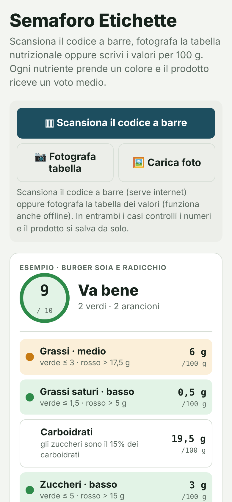
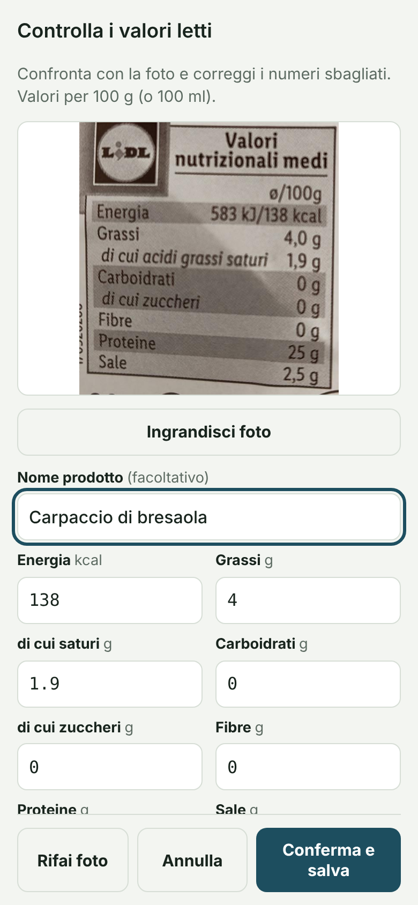

# Semaforo Etichette

App Android gratuita che legge la tabella nutrizionale di un prodotto e dà a ogni nutriente un colore da semaforo, più un voto medio da 0 a 10.

**[⬇ Scarica l'APK dall'ultima release](../../releases/latest)**

<p>


</p>

## Cosa fa

- **Codice a barre**: scansioni il prodotto e i valori arrivano da [Open Food Facts](https://it.openfoodfacts.org), il database alimentare libero (serve internet).
- **Foto della tabella**: se il prodotto non è nel database, fotografi la tabella "Valori nutrizionali" e i numeri vengono letti sul telefono, anche senza internet. Puoi anche caricare una foto dalla galleria.
- **Controllo prima di salvare**: i valori letti si vedono accanto alla foto e si correggono a mano. Poi il prodotto si salva da solo.
- **Semaforo per 100 g** su grassi, grassi saturi, zuccheri e sale; carboidrati, fibre e proteine come informazione e bonus.
- **Correzioni condivise**: con un account Open Food Facts (gratuito) le correzioni e i prodotti nuovi che confermi vanno nel database, e li vede chiunque scansioni quel prodotto. L'app rilegge la scheda dopo l'invio per verificare che i valori ci siano davvero.

## Le soglie (per 100 g)

| Nutriente | 🟢 Basso | 🟠 Medio | 🔴 Alto |
|---|---|---|---|
| Grassi | ≤ 3 g | 3–17,5 g | > 17,5 g |
| Grassi saturi | ≤ 1,5 g | 1,5–5 g | > 5 g |
| Zuccheri | ≤ 5 g | 5–15 g | > 15 g |
| Sale | ≤ 0,3 g | 0,3–1,2 g | > 1,2 g |

Le bevande (per 100 ml) hanno soglie più basse. In app c'è anche l'opzione con le soglie ufficiali britanniche (zuccheri rossi oltre 22,5 g, sale oltre 1,5 g).
Fibre e proteine danno un bonus quando il prodotto è "fonte di" o "ricco di" secondo il Reg. UE 1924/2006.

Il voto è un aiuto per confrontare prodotti, **non un consiglio medico**.

## Installazione

1. Scarica `SemaforoEtichette.apk` dalla [pagina delle release](../../releases/latest).
2. Aprilo sul telefono e consenti l'installazione da "origini sconosciute" quando Android lo chiede.
3. Se compare Play Protect, scegli "Installa comunque".

Serve Android 5.0 o successivo. L'app pesa circa 24 MB perché contiene il motore di lettura del testo.

## Come funziona dentro

- L'interfaccia è una pagina web (`app/assets/index.html`) in un WebView Android minimale (`app/src/.../MainActivity.java`).
- Lettura del testo: modelli [PaddleOCR](https://github.com/PaddlePaddle/PaddleOCR) (rilevamento PP-OCRv4, riconoscimento inglese/latino PP-OCRv4) eseguiti con [ONNX Runtime Web](https://onnxruntime.ai) sul telefono (`ocr/pp.js`).
- Interpretazione della tabella (`ocr/label.js`): riconosce le voci anche lette male, prende la colonna "per 100 g", abbina voci e numeri in ordine anche con righe sfalsate, rimette le virgole perse controllando che le calorie tornino con grassi, carboidrati e proteine.
- Codici a barre: `BarcodeDetector` del sistema quando c'è, altrimenti [ZXing](https://github.com/zxing-js/library) (`ocr/barcode.js`).
- Open Food Facts: lettura con l'API v2, scrittura con l'account dell'utente tramite un piccolo ponte nativo (`OffBridge.java`) che accetta solo indirizzi di Open Food Facts (`ocr/off.js`).

## Compilare da sorgente

Servono gli strumenti Android "legacy" (su Debian/Ubuntu: `aapt apksigner android-sdk-platform-23 dalvik-exchange zipalign` e un JDK).

```sh
KS=/percorso/alla/chiave.keystore KS_PASS=... ./build.sh
```

Lo script produce `build/SemaforoEtichette.apk`. La chiave di firma **non** è nel repository.

## Privacy

Vedi [PRIVACY.md](PRIVACY.md). In breve: niente pubblicità, niente tracciamento, i prodotti salvati restano sul telefono.

## Licenza

Codice dell'app: [MIT](LICENSE). Componenti di terze parti: vedi [third_party/](third_party/).
I dati di Open Food Facts sono disponibili con licenza [ODbL](https://opendatacommons.org/licenses/odbl/1-0/).

Questa app non è affiliata a Open Food Facts.
